# MG4Dash · cockpit

Full-screen launcher for the MG4 and its 1920 × 720 screen, built around Android Auto. This fork of [MG4Dash](https://github.com/Skittle6938/MG4Dash) replaces its home layouts with a single **cockpit** interface: a navigation rail on the left, a climate bar along the bottom, and one screen per area (Inicio, Clima, Energía, Vehículo, Medios, Android Auto, Ajustes). While Android Auto is on screen, a 640 px **strip** keeps the car's essentials next to the projection.

- Developed and tested on the **SWI68** firmware (MT2712, Android 9). The firmware detection and car access of MG4Dash for the other firmwares are kept, but the cockpit has not been tried on them.
- The cockpit is in **Spanish**. The original MG4Dash interface is still available from Ajustes › *Interfaz clásica*.
- Current version: **1.1.12-cockpit.28**, on the `main` branch.

> Screenshots are rendered on a PC with simulated data (see [Screenshots](#screenshots)).

## Inicio
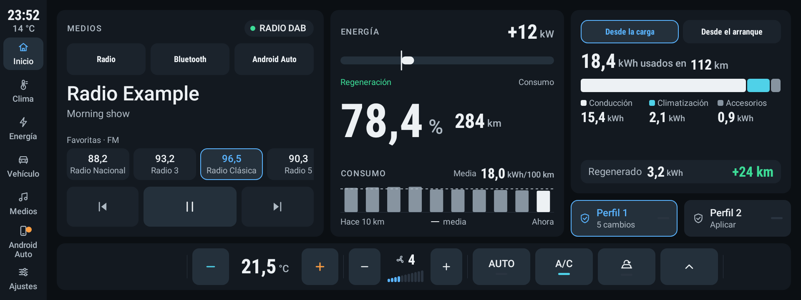
One home screen, parked or driving, with nothing locked while moving.

- **Media**: the car's active source (FM, AM, DAB, Bluetooth, USB, Android Auto), a source selector, and the radio favourites of the current band, one tap to tune.
- **Energy**: battery % to the tenth, range, live power on a two-way bar (regeneration ↔ consumption), and the consumption of the last 10 km against its average.
- **Energy used**: since the last charge or since start-up, split into driving, climate and accessories, with the energy and range recovered by braking.
- **Profiles**: *Perfil 1* and *Perfil 2* apply a set of driving settings with one tap (long press opens them).

## Clima

Temperature (LO · 17 … 32 · HI) with + and − in a column, A/C and AUTO, fan speed 1–11, air direction, recirculation, heated seats and steering wheel where the car has them, and a shortcut to the stock climate app. The climate bar at the bottom of every screen gives the same essentials. The full-screen SAIC climate panel that opens when the climate turns on can be hidden (Ajustes › *Ocultar el panel de clima del sistema*).

## Energía
One view per charge state, each with its own actions.

| Unplugged: summary | Plugged in, not charging |
|---|---|
|  | 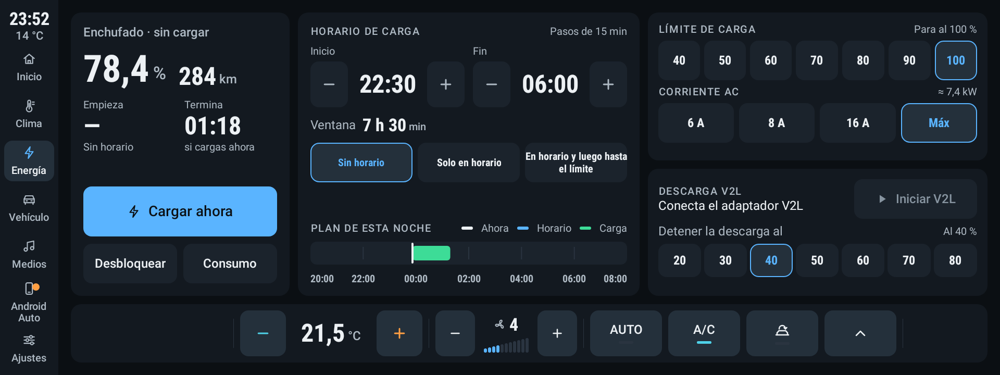 |
| **Charging** | **Charge complete** |
| 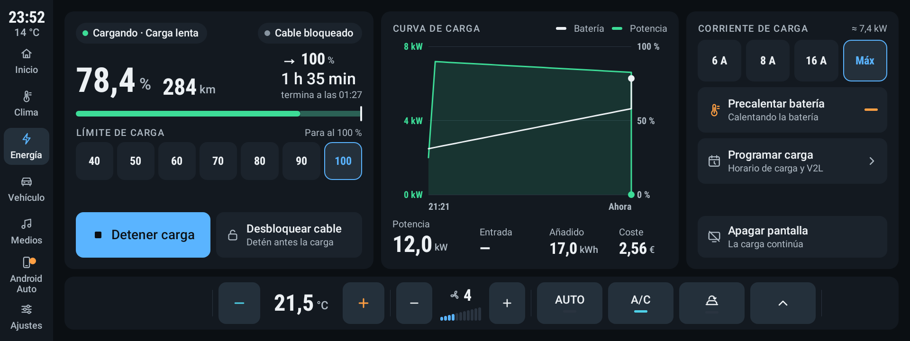 | 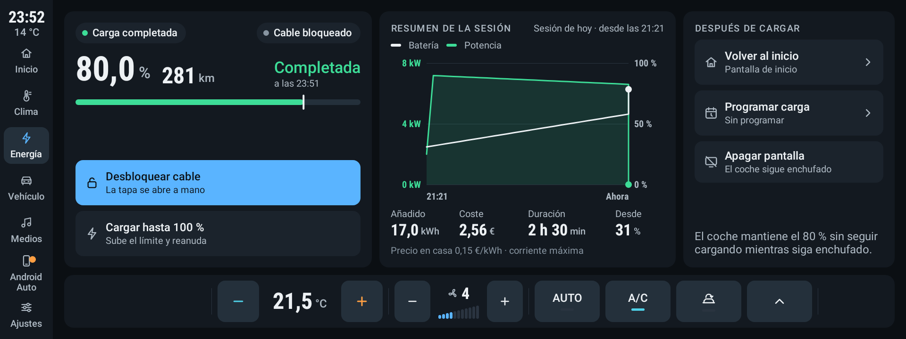 |

- **Summary**: battery, range, average consumption over the last 50 km, battery voltage, current and power; consumption per km over the last 50 km, energy used since the last charge or start-up, and the last 7 days with their cost.
- **Plugged in**: charge now, unlock the cable, charging schedule in 15-minute steps with tonight's plan, charge limit (40–100 %), AC current (6 A, 8 A, 16 A, max).
- **Charging**: time left and end time, a charge curve with battery and power on two axes (touch it to read a point), power, energy added and its cost, stop charging, battery preheating, turn the screen off while charging continues.
- **Charge complete**: session summary (energy added, cost, duration), unlock the cable, or raise the limit and resume.

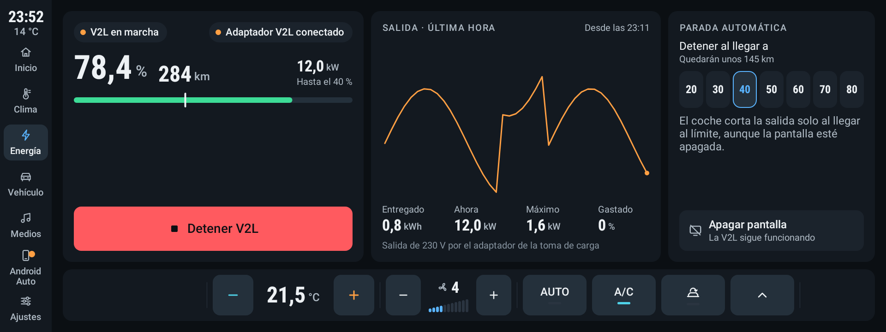
**V2L**: output over the last hour, energy delivered, and the battery level at which the car stops the discharge (20–80 %).

The charts are touchable: tap or drag to read a value. Electricity prices (home and fast charging) and the battery size are set in Ajustes.

## Vehículo and Mi perfil
| Vehicle | Profiles |
|---|---|
|  | 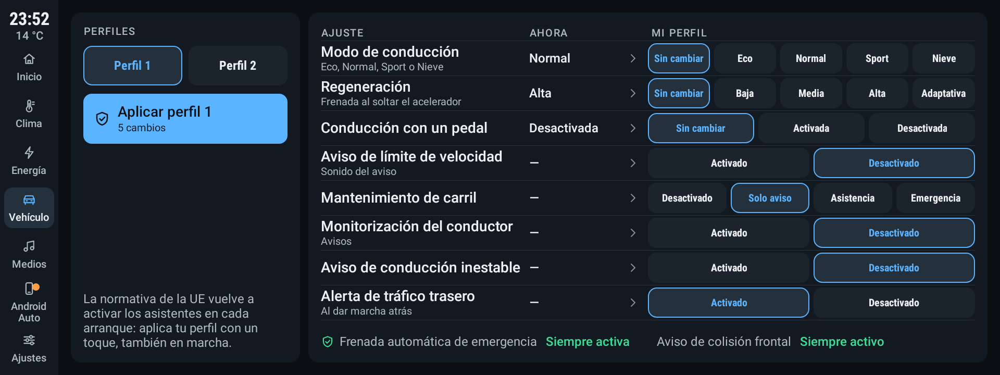 |

- **Vehículo**: tyre pressures and temperatures, odometer, ESC, *Conducción y asistentes* (drive mode, regeneration and one-pedal driving, changed in Mi perfil), shortcuts to the 360° camera, the MG settings and the installed apps, and the **windows**: each one's position with its own down and up arrows (a tap goes all the way, a long press moves while held, a tap while it moves stops it), *Abrir todas* / *Cerrar todas*, and *Cerrar al salir del coche*. Once you have driven above 15 km/h, in P, opening the driver's door or locking the car starts a 5 s countdown with a beep, which you can cancel on screen; then the windows close with the automatic close command (the one with anti-pinch), and any that did not move are held up. The window commands (0 stop, 1 up, 2 down, 3 auto up, 4 auto down) come from [WinClose](https://github.com/Skittle6938/winclose) and the door signal from EVHardware; none of it has been tried on the car yet.
- **Mi perfil**: two profiles that set, or leave unchanged, the drive mode, regeneration, one-pedal driving and the driver assistance settings (speed limit warning, lane keeping, driver monitoring, unsteady driving warning, rear traffic alert). EU rules switch the assistants back on at every start; a profile puts them back the way you want with one tap, also while driving.

## Medios
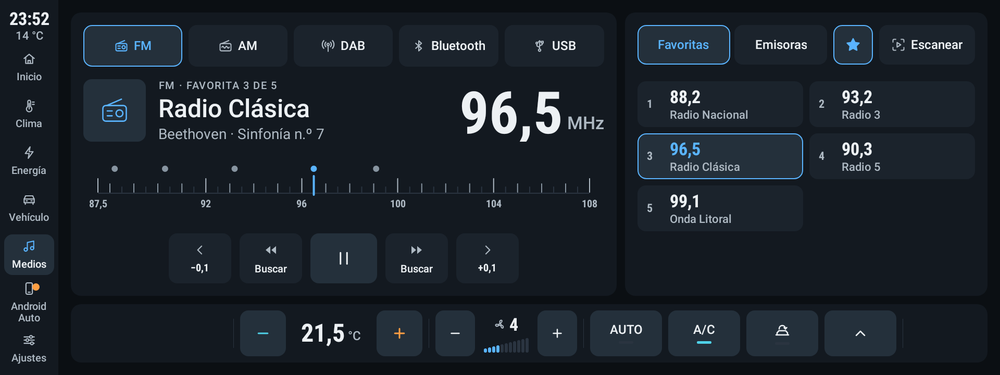
FM, AM and DAB through the car's own radio service, plus Bluetooth and USB: station text, the band with your favourites on it, seek and ±0.1 tuning, favourites and the station list (the favourites are the car's own), scan.

## Android Auto
| Android Auto screen | Strip over Android Auto |
|---|---|
| 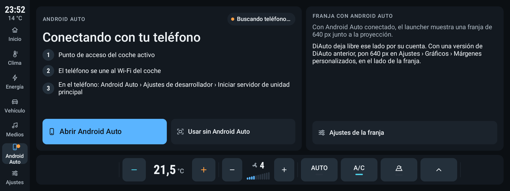 | 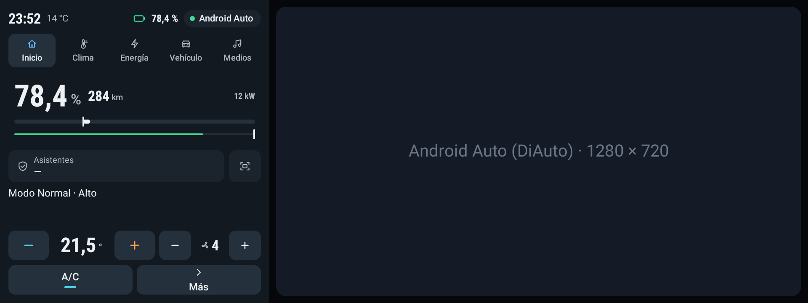 |

Android Auto runs in [DiAuto](https://github.com/DaniCastroDev/DiAuto-MG4). On SWI68 the car's Bluetooth stack refuses the RFCOMM channel wireless Android Auto starts with, so the path that works is DiAuto's **Headunit Server** mode: the phone joins the car's hotspot and runs Android Auto's head unit server (developer settings › *Start head unit server*), and DiAuto connects to it over Wi-Fi. The Android Auto screen walks through those steps.

While DiAuto is in front, MG4Dash draws the **strip** on one side: time, outside temperature, battery, a five-section bar, battery and power, assistants, and a compact climate control whose *Más* opens the full climate sheet over the projection. The side is set in Ajustes › *Lado de la franja*. DiAuto reads it from MG4Dash and leaves that side free by itself (a DiAuto build with this support is needed; with an older one, set 640 px in DiAuto › Ajustes › Gráficos › *Márgenes personalizados*).

## Ajustes and Conexiones
| Ajustes | Bluetooth and hotspot |
|---|---|
|  | 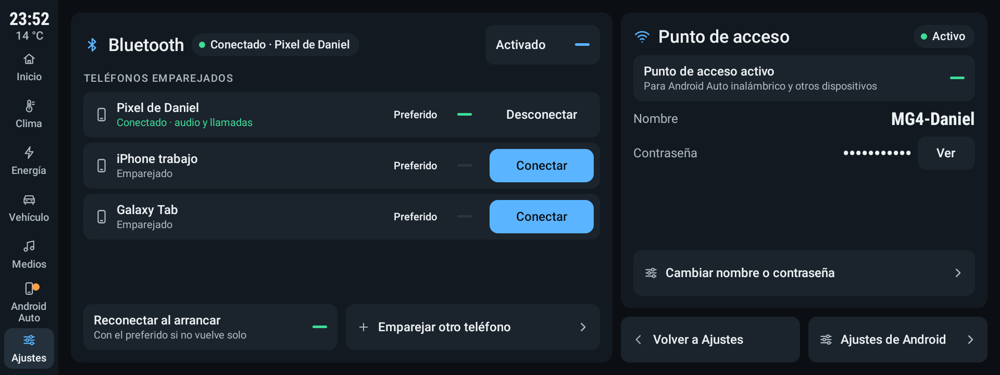 |

- **Ajustes**: strip on/off and side, full screen, dark or light theme, hide the SAIC climate panel, home and fast-charging prices, battery size (51, 64 or 77 kWh gross), *Bluetooth y Wi-Fi*, Android settings, *Usar como inicio* (make MG4Dash the home screen) and *Interfaz clásica*.
- **Conexiones**: paired phones with connect/disconnect and a preferred one, reconnect at start-up, pair another phone; the car's Wi-Fi hotspot on/off with its name and password.

| Light theme |   |
|---|---|
| 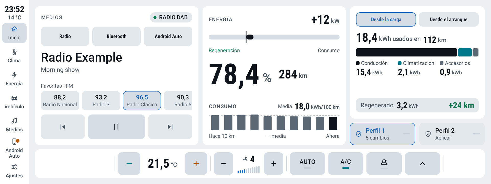 | 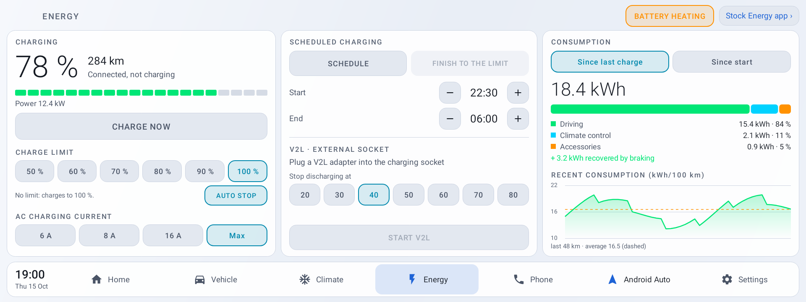 |

## Not yet confirmed on the car

Built and unit-tested, but still to be checked on a real MG4:
- Bluetooth connect / disconnect, the preferred phone and reconnecting at start-up.
- Turning the car's hotspot on and off.
- Switching the car's source to Bluetooth, the radio controls and favourites.
- The order of the consumption list (newest assumed last).
- CPU use of the live power readout (0.2 s refresh).

## Project layout

- `app/src/main/java/app/mg4dash/`
  - `MainActivity.kt`: the cockpit, one activity with the rail and the climate bar; screens are registered by key (`home`, `climate`, `energy`, `vehicle`, `adas`, `media`, `settings`, `connections`, `aa`).
  - `cockpit/`: the UI kit (`Theme.kt` tokens and sizes, `Widgets.kt`, `Icons.kt`, `Shell.kt` rail and climate bar), `screens/` and `strip/` (`StripService` overlay over DiAuto, `StripView`, `StripProvider` for DiAuto).
  - `car/`: car access. `CarBridge.kt` (polled per visible screen), `CarProps.kt` property ids, `LegacyCar.kt` stock launcher SDK on SWI68 / SWI165 / SWI133, `HvacOverlay.kt` (hides the SAIC climate panel), `MockCar.kt` simulated data.
  - `media/`: `SaicRadio.kt` and `Radio.kt` (the car's radio service), `SaicMedia.kt` (Bluetooth / USB source), `MediaHub.kt` (active player).
  - `system/`: `BtControl.kt` (Bluetooth), `Hotspot.kt` (tethering), `HomeSwitcher.kt` (home screen and maintenance mode), `Firmware.kt`.
  - `ClassicActivity.kt`: the original MG4Dash interface.
- `app/src/car/`: car manifest (`sharedUserId=android.uid.system`).
- `app/src/emulator/`: build without the system uid, with simulated data.
- `keys/`: AOSP platform test certificate (public, the same one the car uses).

## Signing key

The private key is not in the repository. It is the AOSP platform test key the SAIC apps are signed with:

```bash
curl -sL "https://android.googlesource.com/platform/build/+/refs/heads/main/target/product/security/platform.pk8?format=TEXT" | base64 -d > keys/platform.pk8
```

## Build

```bash
JAVA_HOME=$(/usr/libexec/java_home -v 17) sh ./gradlew --no-daemon assembleCarRelease
BT=~/Library/Android/sdk/build-tools/36.0.0
mkdir -p dist
$BT/zipalign -f -p 4 app/build/outputs/apk/car/release/app-car-release-unsigned.apk dist/aligned.apk
$BT/apksigner sign --key keys/platform.pk8 --cert keys/platform.x509.pem \
  --v1-signing-enabled true --v2-signing-enabled true --v3-signing-enabled false \
  --out dist/MG4Dash-<version>.apk dist/aligned.apk
```

On Windows, `.\sign_platform.ps1` builds and signs in one go. Every delivery bumps `versionCode` and `versionName` (`1.1.12-cockpit.N`) in `app/build.gradle.kts`.

### Emulator

The `emulator` flavour (`app.mg4dash.emu`) runs with simulated data on a 1920 × 720, 160 dpi AVD:

```bash
adb shell am start -n app.mg4dash.emu/app.mg4dash.MainActivity --es screen energy
adb shell am start -n app.mg4dash.emu/app.mg4dash.MainActivity --es mock startCharge
```

`screen`: `home`, `climate`, `energy`, `vehicle`, `adas`, `media`, `settings`, `connections`, `aa`. `mock`: `drive`, `plug`, `unplug`, `startCharge`, `stopCharge`, `chargeDone`, `chargeError`, `startV2L`, `stopV2L`, `strip`.

### Screenshots

```bash
JAVA_HOME=$(/usr/libexec/java_home -v 17) sh ./gradlew testEmulatorDebugUnitTest --tests 'app.mg4dash.CockpitScreenshotTest'
```

writes the README screenshots to `app/build/screenshots/cockpit/` (Robolectric, 1920 × 720, simulated data); copy them to `docs/screenshots/`.

## Install on the car

Copy the signed APK to a USB stick and install it from the head unit's Files app, or with adb (a plain `adb install` is refused for a platform-signed app):

```bash
adb push MG4Dash-<version>.apk /data/local/tmp/x.apk
adb shell pm install -r -f /data/local/tmp/x.apk
adb shell rm /data/local/tmp/x.apk
```

Then make it the home screen from Ajustes › *Usar como inicio*. This only disables the SAIC home activity, whose HOME priority cannot be beaten otherwise; the SAIC launcher package keeps running, since its service handles the camera, the audio sources and some SystemUI commands.

### Updates from GitHub

Once a version is installed, Ajustes › Sistema › *Buscar actualización* checks the latest release of this repository (pre-releases are ignored). If it is newer, a second tap on *Instalar <version>* downloads the APK, checks its size and the SHA-256 GitHub lists for it, installs it with `PackageInstaller` and restarts MG4Dash. The car needs Internet for this (its own SIM, or Wi-Fi).

To publish a version, bump `versionCode` and `versionName`, commit and push `main`, then:

```bash
sh release.sh --publish notes.md
```

It builds and signs the APK like above and creates the release `v<version>` with that APK and `notes.md` as its notes; the first bullet of the notes is shown next to the button. Without `--publish`, it only builds and signs.

## Going back

- Maintenance mode gives the home screen back to the SAIC launcher: Ajustes › *Interfaz clásica*, then the classic settings › *Modo mantenimiento*. Before a firmware update, turn it on, so the car keeps a home screen if the update removes MG4Dash.
- `adb shell pm enable com.saicmotor.launcher/.view.MainActivity` is refused on this head unit; only MG4Dash can re-enable the SAIC home.
- If MG4Dash no longer starts after an update (`ClassNotFoundException` or `oat_file ... Check failed` in logcat): `adb shell am force-stop app.mg4dash`, `adb shell cmd package compile -m speed -f app.mg4dash`, `adb shell am force-stop app.mg4dash`, then `adb shell cmd package set-home-activity --user 0 app.mg4dash/.MainActivity`. Always force-stop first: compiling while it runs corrupts its compiled code.
- Uninstall: `adb uninstall app.mg4dash`.

## Credits

- [MG4Dash](https://github.com/Skittle6938/MG4Dash) (Skittle6938): the launcher this cockpit is built on, its car access, firmware detection and the classic interface. If it is useful to you, you can support its author on [Ko-fi](https://ko-fi.com/skittle6938).
- [MG4Control](https://github.com/SliDeeN/MG4Control) (SliDeeN): documentation of the A9 carapi path, of the climate and air-direction ranges, and of the per-firmware car access.
- [MG4-Custom-Launcher](https://github.com/adammcdonagh/MG4-Custom-Launcher) (adammcdonagh): Bluetooth album art, the discovery of the AOSP test keys and the stock launcher SDK on SWI68.
- [MG4_Simple_Launcher](https://github.com/Tommasov/MG4_Simple_Launcher) (Tommasov): notes on the vehicle adapter service of other firmwares.
- [DiAuto-MG4](https://github.com/merthankaraman/DiAuto-MG4) (merthankaraman): Android Auto on the MG4 head unit.
- Weather by [Open-Meteo](https://open-meteo.com/), maps © [OpenStreetMap](https://www.openstreetmap.org/copyright) contributors in the classic interface.

## Licence

MG4Dash is free software under the [GNU General Public License v3](COPYING) or later. Parts of the firmware detection and of the SWI68 / SWI165 / SWI133 climate code are adapted from [MG4Control](https://github.com/SliDeeN/MG4Control) (GPL v3; earlier MG4Control code under the MIT licence, notice kept in [licenses/MG4Control-MIT.txt](licenses/MG4Control-MIT.txt)).

Personal project, not affiliated with SAIC / MG. Use at your own risk.
