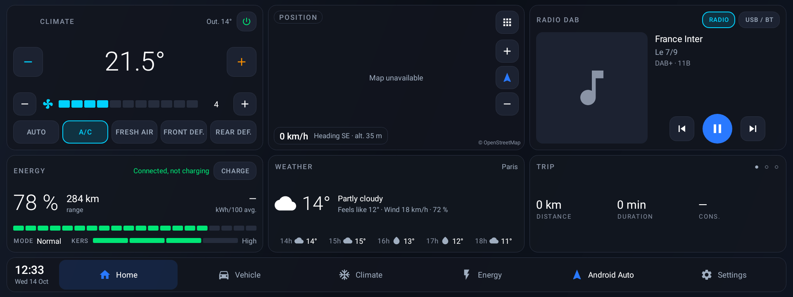
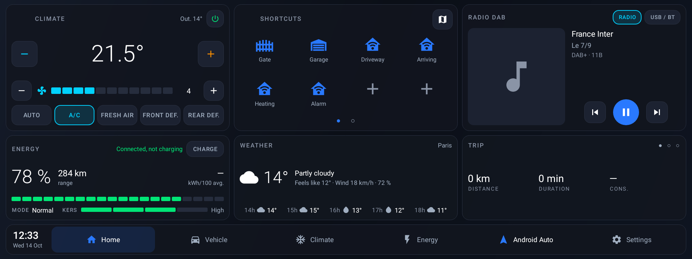
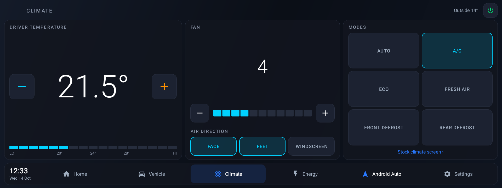
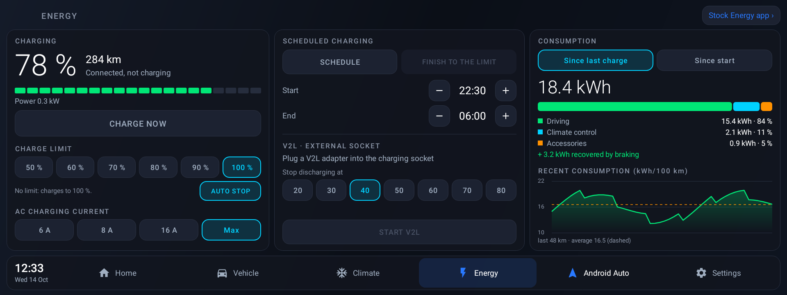
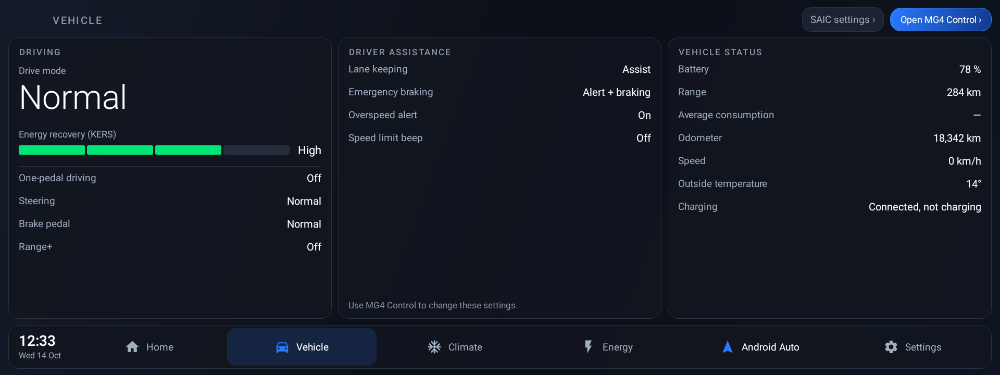
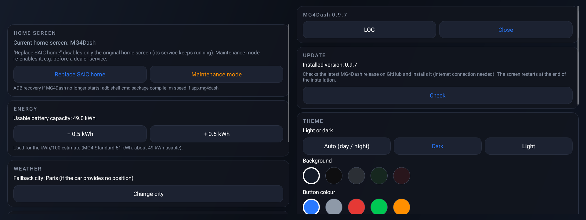

# MG4Dash

Launcher plein écran pour MG4 Standard (firmware SWI69, famille A9), dalle 1920 × 720 : style « dark glass », accueil en 3 colonnes et pages Clim, Énergie et Véhicule reliées par un dock commun.

Langues : anglais (par défaut), français, allemand, espagnol, italien et néerlandais, selon la langue de la voiture.

> Captures rendues sur PC avec des données simulées (la carte OpenStreetMap ne s'affiche que sur la voiture).

### Accueil

Clim (température, ventilation, AUTO, A/C, recyclage, dégivrage), énergie (batterie, autonomie, conso estimée, mode, KERS, bouton Charger / Lancer V2L), position du véhicule, météo Open-Meteo, lecteur média qui suit la source audio active de la voiture (radio DAB/FM, Bluetooth, USB, Android Auto) et widget trajet / statut / météo.

Appui long sur le bouton Android Auto du dock : le remplacer par l'appli de son choix.

### Raccourcis et Home Assistant

Le bouton en haut à droite de la carte la remplace par 2 pages de 4 × 2 raccourcis : applis ou actions Home Assistant (scripts, automatisations, scènes, boutons, portail, porte de garage…). Toucher une case vide ou appui long pour la modifier. Adresse et jeton Home Assistant dans les paramètres du launcher.

### Climatisation

Température au pas de 1° (LO → HI), ventilation, direction de l'air combinable, modes AUTO, A/C, ECO, recyclage et dégivrage avant / arrière.

### Énergie

Recharge (démarrer / arrêter, limite de charge appliquée par MG4Dash, courant AC), charge programmée, V2L (seuil d'arrêt, démarrer / arrêter) et consommation (conduite, clim, accessoires, récupération, courbe des derniers km).

### Véhicule

Mode de conduite, KERS, aides à la conduite et état du véhicule en lecture seule, avec un raccourci vers MG4 Control.

### Paramètres du launcher

Écran d'accueil (remplacer l'accueil SAIC / mode Entretien), capacité batterie, ville météo, démarrage, plein écran, Home Assistant et journal intégré.

## Arborescence

- `app/src/main/java/app/mg4dash/` : l'appli (Kotlin)
  - `car/CarBridge.kt` : accès véhicule par `com.saicmotor.caradapter` (clim code 7, EV code 4, réglages code 8, général code 1)
  - `energy/ConsumptionEstimator.kt` : conso kWh/100 estimée à partir du % batterie et des km
  - `media/MediaHub.kt` : lecteur actif (radio, Bluetooth, USB, Android Auto) par MediaSessionManager
  - `weather/WeatherRepo.kt` : météo Open-Meteo
  - `system/HomeSwitcher.kt` : mode Valet / Entretien (rend le launcher SAIC par défaut)
  - `LauncherApp.kt` : garde-fou, après 3 plantages en 3 min le launcher SAIC redevient l'accueil
- `car/CarApi.kt` : clients binder écrits pour MG4Dash (descripteurs et numéros de transaction relevés sur la voiture)
- `app/src/car/` : manifeste voiture (`sharedUserId=android.uid.system`)
- `app/src/emulator/` : version sans uid système, données simulées
- `keys/` : clé plateforme AOSP de test (publique, la même que celle de la voiture)

## Clé de signature

La clé privée n'est pas versionnée. Récupérer la clé plateforme AOSP de test (la même que celle des applis SAIC) :

```powershell
$u = "https://android.googlesource.com/platform/build/+/refs/tags/android-9.0.0_r61/target/product/security/platform.pk8?format=TEXT"
[IO.File]::WriteAllBytes("keys\platform.pk8", [Convert]::FromBase64String((Invoke-WebRequest $u -UseBasicParsing).Content))
```

## Compiler

```powershell
.\sign_platform.ps1            # version voiture signée → dist\MG4Launcher-car-<version>.apk
.\gradlew.bat testEmulatorDebugUnitTest   # captures 1778×720 → app\build\screenshots\
```

## Installer sur la voiture (étape 4, sur accord explicite)

1. `adb install -r dist\MG4Launcher-car-0.1.0.apk`
2. Essai sans changer l'accueil : `adb shell am start -n app.mg4dash/.MainActivity`
3. En faire l'accueil : appui long sur « Paramètres » > « Remplacer l'accueil SAIC » (désactive seulement l'activité d'accueil SAIC, qui a une priorité HOME de 2 indépassable autrement)

Le launcher SAIC (`com.saicmotor.launcher`) n'est jamais désactivé : son service gère la caméra, les sources audio et des commandes de SystemUI.

## Revenir en arrière

- Mode Entretien : appui long sur « Paramètres » dans le dock, puis « Activer le mode Entretien ».
- Par ADB : `adb shell pm enable com.saicmotor.launcher/.view.MainActivity`
- Désinstaller : `adb uninstall app.mg4dash`

## Gestes

- Appui long sur « Paramètres » dans le dock : paramètres du launcher (mode Entretien, capacité batterie, ville météo, journal)
- Appui long sur « Accueil » dans le dock : liste des applis installées
- Toucher le widget en bas à droite : trajet → statut → météo
- Appui long sur la température : appli clim SAIC

## Crédits

- [MG4Control](https://github.com/SliDeeN/MG4Control) (SliDeeN) : documentation de la voie carapi A9, des bornes de la clim et de la direction de l'air.
- [MG4-Custom-Launcher](https://github.com/adammcdonagh/MG4-Custom-Launcher) (adammcdonagh) : pochettes Bluetooth et découverte des clés de test AOSP.
- Cartes © contributeurs [OpenStreetMap](https://www.openstreetmap.org/copyright) (osmdroid), météo [Open-Meteo](https://open-meteo.com/).

Projet personnel, sans lien avec SAIC / MG. Utilisation à vos risques.
